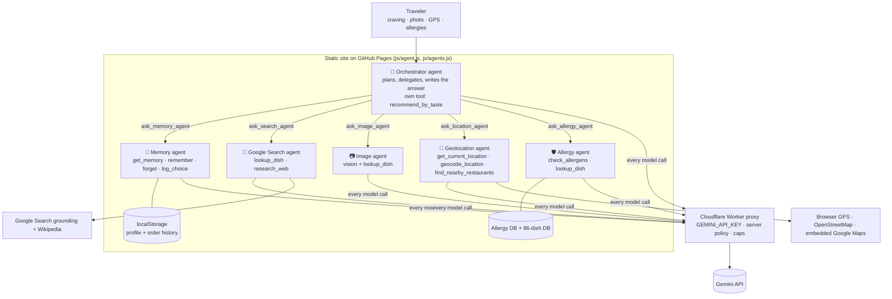

# 🌍 Global Foodie: an agentic food guide for travelers

Global Foodie helps travelers abroad decide **what to order**. It works from where they are, what they like, and what they can't eat. It runs entirely in the browser and is hosted on GitHub Pages: no server and no build step.

## Milestone II at a glance

| Requirement | Where |
|---|---|
| **Public link** | `https://YOUR-USERNAME.github.io/global-foodie/`: GitHub Pages plus a Cloudflare Worker, both always on, no login and no laptop needed (setup in sections 4–5) |
| **Expansion beyond Milestone I** | **Multi-agent:** an orchestrator plus five specialist agents (Memory, Google Search, Image, Geolocation, Allergy). Each has its own prompt, tools and budget, with a written reason for each (section 3). Also **memory** (a persistent profile and order history) and real tools (Google Search grounding, OpenStreetMap, an embedded Google Map). *(Edit to match what your Milestone I had.)* |
| **Evaluation (pass@1 / pass^k)** | [`eval/`](eval/README.md): 16 cases (4 adversarial, 4 edge, including a menu photo) × 3 trials. Run `GEMINI_API_KEY=… node eval/run_eval.mjs`, and the report goes to `eval/results/report.md` |
| **Governance note** | [`GOVERNANCE.md`](GOVERNANCE.md) |
| **Human gate** | Approve/Deny card in the chat, showing the tool name and JSON arguments, before `remember`, `forget`, `log_choice` and `get_current_location` |
| **Cost caps** | Per message: 8 orchestrator calls, 18 model calls and 24 tool calls across all agents, plus a per-agent step limit. Per chat: 20 messages. Per answer: 2,048 output tokens. Per IP: 60 requests per minute. Per request: 8 MB. Enforced in the browser (`js/config.js`, `js/agents.js`) **and** on the server (`proxy/worker.js`) |
| **Keys** | Only as a Cloudflare secret (`wrangler secret put GEMINI_API_KEY`). Never in the repo or the UI |
| **Nothing real connected** | No email, payments, bookings or deletions. Tools only read public data or write to the visitor's own browser |

### Pre-share checklist
- [ ] Repo pushed to GitHub, Pages source set to **GitHub Actions**, secrets added
- [ ] Worker deployed (Actions → Deploy proxy), `ALLOWED_ORIGINS` contains `https://YOUR-USERNAME.github.io`
- [ ] Repository variable `PROXY_URL` set and the Pages workflow re-run (the demo banner is gone)
- [ ] Spending cap or budget alert set on the Gemini key in Google AI Studio / Cloud Console
- [ ] Open the link on your phone with Wi-Fi **off**, and send a message: it answers
- [ ] Ask it to remember an allergy: the 🔒 approval card shows the arguments
- [ ] Ran the eval (Actions → Evaluation, or locally), committed `eval/results/`, and wrote the failure explanations in `report.md`
- [ ] Filled in your name in `GOVERNANCE.md`

## 1. Business problem

Travelers often find a restaurant and still can't decide what to order. The menu is in another language, the dishes are unfamiliar, and ingredients, spice levels and portion sizes aren't clear. Allergies and dietary restrictions make this harder, and sometimes risky.

**Target users**
1. Travelers abroad
2. Travelers with food allergies or dietary restrictions
3. Travelers who want to try authentic local dishes but need help understanding them

**Why agentic?** Picking a dish takes several steps and several sources of information. You have to find out where the user is, research unfamiliar dishes, cross-check ingredients for allergens, compare options with the user's tastes, find nearby places and ask follow-up questions. Global Foodie's LLM **decides which tools to call, in what order, and when it has enough information**. No developer hard-codes that workflow, and it changes with each request (a menu photo, "near me", an allergy that rules out the obvious dish, and so on).

## 2. Use-case scenarios

Built for the **United States**: distances in miles and feet, FDA "Big 9" allergens, English staff cards (plus Spanish where useful), U.S. tipping and tax tips for visitors, and 34 U.S. regional dishes in the database.

**App flow:**
1. *Where are you?* Use my location, or type a city. An embedded **Google Map** appears, with a **Pins** tab and a list of nearby restaurants.
2. *Anything you can't eat?* This step is optional. It lists the FDA Big 9, other common allergies (gluten/celiac, lactose, mollusks, mustard, celery, corn, coconut, sulfites, lupin, red meat/alpha-gal) and diets. There's a **"Not listed?"** box for anything else (kiwi, cilantro, garlic…), and you can choose "No restrictions" or skip it.
3. *What are you in the mood for?* Pick from **Craving for…** chips (noodles, something spicy, seafood, BBQ, tacos, pizza, soup, sushi, curry, burger, something light, something sweet, comfort food, local specialty, cheap eats) and/or type your own craving, then tap **Find my food**. Or **upload a photo**: **📷 Upload my food** (a dish: what is it, and can I eat it?) or **📜 Upload a menu** (what should I order?). The 📷 button in the chat box works any time. The orchestrator and its agents take it from there, and the map updates with the places they recommend.

**Sample scenarios** (the 🧳 button, or the cards on the start screen). Each one loads a sample traveler and asks the agent:

| Scenario | Location | Shows |
|---|---|---|
| 🥜 Peanut allergy, craving noodles | Bangkok | Avoiding Pad Thai, safe noodle swaps, staff card in Thai |
| 🌶️ Loves Cava's harissa, wants a new cuisine | Washington, DC | Taste matching across cuisines (salsa verde) |
| 🦐 Shellfish allergy, wants Cajun & Creole | New Orleans | Hidden seafood stock, shared fryers |
| 🌾 Celiac at Texas BBQ & Tex-Mex | Austin | Sauces, flour vs. corn tortillas |
| 🥛 Dairy-free, wants New England seafood | Boston | Web research (Manhattan chowder) + checking unknown dishes |
| 🌿 Unlisted allergy (cilantro) | San Diego | Custom allergies typed by the user |
| 🥩 Red meat allergy (alpha-gal) at BBQ | Kansas City | A U.S.-specific allergy, lard/tallow, sides |
| 🗽 First-time visitor from Japan | New York | No restrictions, ordering and tipping tips |

**A. Peanut allergy, wants noodles in Thailand**
> (location shared in step 1) "I'm allergic to peanuts and I really want noodles."

`get_current_location` (step 1, shown on the map) → `remember(allergy: peanut)` → `recommend_by_taste(Thailand, noodles)` → `check_allergens(Pad Thai)` gives **avoid** → `check_allergens(Pad See Ew / Pad Kee Mao / Khao Soi)` → `find_nearby_restaurants(thai;noodle)` → the agent recommends alternatives with distances and map links, plus a "show this to staff" card in Thai.

**B. Loves spicy harissa, wants a new cuisine**
> "I love the spicy harissa from Cava, but I don't want Mediterranean food today."

Location comes from step 1, and the traveler skipped the allergy step → `remember(like: spicy harissa)` → turns "harissa" into flavor tags (spicy, smoky, garlicky, chili-paste) → `recommend_by_taste(avoid: Mediterranean, Middle Eastern, North African)` → suggests jerk chicken, tacos al pastor, mapo tofu and chilaquiles verdes, explaining that salsa verde is spicy and tangy → `find_nearby_restaurants` puts pins on the map → the agent offers to double-check for allergies, without requiring them → the user picks one → `log_choice`.

**C. Menu photo (image search)**
> 📷 *uploads a photo of a Thai menu* "I'm allergic to peanuts. What can I order from this?"

The vision model reads and translates the items → `lookup_dish` / `research_web` for unknown items → `check_allergens` with the ingredients it found → a ranked list for this user.

## 3. System design: an orchestrator and five agents



**How a message flows.** The traveler picks what they're craving ("Craving for: noodles, something spicy"). The orchestrator plans and calls the agents it needs as tools. Independent agents run **in parallel**: for example the Geolocation and Google Search agents together, then the Allergy agent with all candidate dishes. Each agent runs its own Gemini tool-calling loop with its own prompt, tools and step budget, and returns a short report. The orchestrator combines the reports into the answer.

Memory writes and GPS still pause at the 🔒 **approval gate**, whichever agent asks. The **Agent trace** panel shows each delegation, with that agent's own tool calls nested under it.

### The five agents

| # | Agent (design goal) | What it does | Tools (only these) | Where you see it | Eval cases |
|---|---|---|---|---|---|
| 1 | 🧠 **Memory agent**: remember the traveler's preferences and previous choices | **Recall:** reads the profile and order history and reports what's relevant ("you rated the khao soi 5★ last time"). **Save:** stores allergies, diets, likes, dislikes, spice tolerance and the dish you chose. Saving goes through the approval gate. | `get_memory`, `remember`, `forget`, `log_choice` | **Memory** tab; "🧠 Based on my past choices" | C09, C13 |
| 2 | 🔎 **Google Search agent**: research dishes, ingredients, cultural context, restaurants | Checks the built-in database first, then makes up to 3 web searches through **Gemini with Google Search grounding** (sourced answers), plus Wikipedia for summaries and dish photos. Reports ingredients, allergens, spice, how to order and cultural notes, with source links. | `lookup_dish`, `research_web` | Source links in answers; Google search suggestions | C05, C15 |
| 3 | 📷 **Image agent**: understand menu photos and dish photos | Gets the photo (the orchestrator doesn't, which saves tokens). For a **menu**, it transcribes and translates every item with prices and likely ingredients. For a **dish**, it identifies it with a confidence level. It leaves safety to the Allergy agent. | Gemini vision, `lookup_dish` | "📷 Upload my food" / "📜 Upload a menu" in step 3; 📷 in the chat box | **C16** |
| 4 | 📍 **Geolocation agent**: determine where the traveler is | Uses the saved location, a typed place or GPS (with approval). Finds restaurants that fit the craving (OpenStreetMap), with distance in miles and walking time, and puts them on an **embedded Google Map**, a pins map and a list. | `get_current_location`, `geocode_location`, `find_nearby_restaurants` | Map card at the top | C01–C08, C10 |
| 5 | 🛡️ **Allergy agent**: cross-check potential allergens | Checks **every candidate dish in one batch** against 22 allergens and diets (FDA Big 9, EU 14, gluten, corn, coconut, alpha-gal, vegetarian, vegan, halal, kosher…) plus any allergy the user typed. Gives a ⛔ / ⚠️ / ✅ verdict with evidence, and never softens an "avoid". | `check_allergens`, `lookup_dish` | ✅ / ⚠️ / ⛔ in answers; "Show this to staff" card | C01, C03–C07, C11, C15, C16 |

**🤖 Orchestrator:** turns the craving into dishes and flavors (`recommend_by_taste` over 86 dishes, 34 of them U.S. regional), decides which agents to call, enforces the safety rules, and writes the final answer.

### Why separate agents instead of one agent with many tools
1. **Least privilege.** Each agent can only call its own tools. Only the Memory agent can write memory, and only the Geolocation agent can read GPS. A prompt injection in a web page or a menu photo can't make the Search or Image agent save anything.
2. **Focused context.** Each agent gets a short role prompt and only the data it needs. The photo goes only to the Image agent, and the allergy rules sit in the Allergy agent's prompt, so the orchestrator's context stays small and the safety check doesn't get lost in a long prompt.
3. **Parallelism.** Independent work, like location plus research, runs at the same time.
4. **Different model capabilities.** The Image agent uses vision, and the Search agent uses Google Search grounding. Both are kept apart from the orchestrator's function calling.

**Safety rules:** allergies are optional, but when any are on file the Allergy agent checks every candidate dish, and the orchestrator never recommends an "avoid" dish. Text in messages, photos and web pages is treated as data. The proxy adds a server policy to every agent's prompt, and callers can't remove it.

## 4. Set up your Gemini key (one time)

Your key must **never** be in the website's files: everything on GitHub Pages is public, and anyone could copy a key from the browser's dev tools. Instead, a small free **Cloudflare Worker** (`proxy/worker.js`) stores the key as an encrypted secret. The website calls the Worker, and the Worker adds the key and forwards the request to Gemini. Visitors never need a key.

**a. Get a Gemini key.** Go to Google AI Studio (aistudio.google.com), choose **Get API key**, and create one. While you're there, set a usage cap or budget alert on the Google Cloud project.

**b. Deploy the Worker.** You need a free Cloudflare account and Node.js.
```bash
cd proxy
# edit wrangler.toml: replace YOUR-USERNAME in ALLOWED_ORIGINS with your GitHub username
npx wrangler login
npx wrangler secret put GEMINI_API_KEY      # paste your key when prompted; it's stored encrypted
npx wrangler deploy                          # prints https://global-foodie-proxy.<subdomain>.workers.dev
```
*No command line?* In the Cloudflare dashboard, go to **Workers & Pages → Create → Worker**, paste the contents of `worker.js`, and deploy. Then under **Settings → Variables and Secrets**, add the secret `GEMINI_API_KEY` and the text variable `ALLOWED_ORIGINS`. (Without wrangler.toml, the per-IP rate limit is off.)

**c. Point the site at the Worker.** Open `js/config.js` and set `PROXY_URL` to the Worker URL. This URL is not a secret.

**d. Google Maps (optional key).** The embedded Google Map works with no key, using Google's basic embed. For the official Maps Embed API, create a **separate** key in Google Cloud Console:
- Enable "Maps Embed API".
- Restrict the key to the website `https://<you>.github.io/*`.
- Put it in `GOOGLE_MAPS_EMBED_KEY` in `js/config.js`.

This key is designed to be public, but restrict it to your site. Never reuse your Gemini key here.

**Testing the Worker on your computer (optional):** copy `proxy/.dev.vars.example` to `proxy/.dev.vars`, paste your key there, run `npx wrangler dev`, and set `PROXY_URL` to `http://localhost:8787`. `.dev.vars` is gitignored, so the key stays on your machine.

**Protections built into the proxy:**
- It only accepts requests from the sites in `ALLOWED_ORIGINS`.
- It allows 30 requests per minute per visitor.
- It caps request size.
- It forwards only the fields the app needs, so it can't be used as a general Gemini relay.
- The model is chosen on the server: `GEMINI_MODEL`, which defaults to `gemini-flash-latest`.

Origin checks stop other websites from using your key, but not scripts, so keep the Google usage cap.

## 5. Run and deploy the site

Run it locally:
```bash
python3 -m http.server 8000     # from the project folder, then open http://localhost:8000
```

### Publish on GitHub Pages (no code edits needed)

**A. Put the site online (about 5 minutes; it starts in demo mode)**
1. On github.com, create a new **public** repository named `global-foodie`. Leave it empty: no README, license or .gitignore.
2. In that repo, go to **Settings → Pages → Build and deployment → Source** and choose **GitHub Actions**. Do this before pushing.
3. Push this folder from your computer. It already contains a git repository:
   ```bash
   cd global-foodie
   git remote add origin https://github.com/<you>/global-foodie.git
   git push -u origin main
   ```
   If git asks for a password, use GitHub Desktop, run `gh auth login`, or use a personal access token (not your GitHub password).
4. Open the **Actions** tab and wait for the green ✓ on "Deploy site to GitHub Pages". Your site is live at **`https://<you>.github.io/global-foodie/`** and runs in demo mode.

**B. Switch on the full Gemini agent (about 10 minutes, one time)**
1. Create a free account at cloudflare.com. Go to **My Profile → API Tokens → Create Token → "Edit Cloudflare Workers"** template, and copy the token. Then copy your **Account ID** from **Workers & Pages**.
2. In the repo, go to **Settings → Secrets and variables → Actions → Secrets** and add:
   - `GEMINI_API_KEY`
   - `CLOUDFLARE_API_TOKEN`
   - `CLOUDFLARE_ACCOUNT_ID`
3. Go to **Actions → "Deploy proxy (Cloudflare Worker)" → Run workflow**. When it finishes, copy the `https://global-foodie-proxy.<…>.workers.dev` address from its log. The Worker only accepts requests from your `github.io` site, and the workflow sets that up automatically.
4. Go to **Settings → Secrets and variables → Actions → Variables → New variable**: name `PROXY_URL`, value the address from step 3.
5. Go to **Actions → "Deploy site to GitHub Pages" → Run workflow**. The site now runs the full agent: the demo banner disappears.
6. Test it on your phone with Wi-Fi off. Set a spending cap on your Gemini key in Google AI Studio.

| Workflow | Runs when | Does |
|---|---|---|
| `pages.yml` | push to `main`, or by hand | Publishes the site, using the `PROXY_URL` variable if it's set |
| `deploy-proxy.yml` | `proxy/` changes, or by hand | Deploys the Worker with your key as an encrypted secret. Skips cleanly until the secrets exist |
| `eval.yml` | push (no-key self-test) / by hand (real eval) | Runs the evaluation harness. The report appears on the run's page |

Search grounding note: Google's terms require showing its "Search Suggestions" alongside answers that used Google Search. Global Foodie shows them under the reply in a sandboxed frame.

## 6. Project structure

```
index.html            UI shell
style.css             styles (mobile-friendly)
js/config.js          PROXY_URL (public, no secrets)
js/app.js             UI: chat, photo upload, trace panel, memory panel
js/agent.js           orchestrator + shared agent loop (gate, caps, parallel delegation), Gemini adapter
js/agents.js          the five specialist agents: role prompts, tools, budgets
js/tools.js           tool definitions and implementations
js/memory.js          persistent traveler profile
js/markdown.js        small, safe markdown renderer
js/map.js             map card (Leaflet + OpenStreetMap; drawn fallback)
js/preview.js         preview/demo mode (scripted scenarios, no API calls)
js/scenarios.js       the 8 sample scenarios (shared by live and preview modes)
js/units.js           miles/feet formatting
js/data/dishes.js     dish knowledge base (86 dishes, 15+ cuisines, 34 U.S. regional)
js/data/allergens.js  allergy and diet database + matcher
proxy/worker.js       Cloudflare Worker that holds the Gemini key
proxy/wrangler.toml   Worker config (allowed origins, model, rate limit)
proxy/.dev.vars.example  template for a local-only key file
eval/                 evaluation harness, 16 test cases, menu-photo fixture
.github/workflows/    GitHub Actions: Pages deploy, Worker deploy, evaluation
GOVERNANCE.md         governance note
```

## 7. Limitations and next steps

- Dish data is the **typical recipe**. Kitchens vary and cross-contact happens, so the agent always says to confirm with staff. It is not medical advice.
- OpenStreetMap has no menus, so restaurant matches are based on cuisine ("likely serves").
- Free public APIs (Nominatim, Overpass) are rate-limited. Heavy use needs your own instance or a paid places API (Google Places, Yelp).
- Ideas: a translated allergy card shown full-screen, an offline mode, Google Maps grounding for richer restaurant data, an evaluation set of scenarios with expected tool sequences.

*Data © OpenStreetMap contributors; summaries from Wikipedia (CC BY-SA).*
